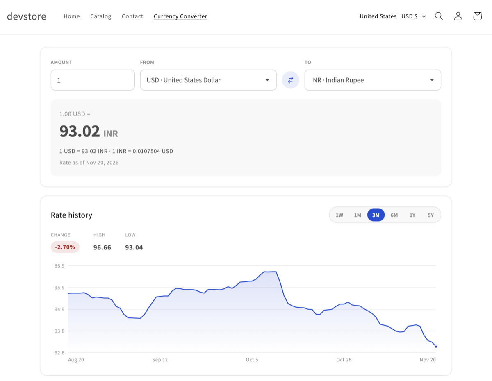

# Currency Converter for Shopify

[](https://github.com/kul3101/shopify-currency-converter/actions/workflows/ci.yml)
[](LICENSE)

A Shopify app that adds a currency converter block to the storefront, backed by the
[Frankfurter API](https://frankfurter.dev). A shopper picks any currency Frankfurter
supports as From and To, sees the current exchange rate, converts an amount, swaps the
pair with one click, and sees how the rate has moved over time on a chart.

This is a port of the Magento 2 module `Sidelah_CurrencyConverter` to a Shopify app
built on the Shopify CLI React Router template.



## Features

- All currencies from Frankfurter v2 (`/v2/currencies`), grouped as Currencies,
  Precious metals and Cryptocurrencies.
- Latest rate lookup (`/v2/rate/{base}/{quote}`) with the amount converted both ways
  and the date the rate was published.
- A swap control that flips From and To and reloads the rate and chart.
- A historical chart with 1W, 1M, 3M, 6M, 1Y and 5Y ranges, built from `/v2/rates`.
  1Y uses weekly points and 5Y uses monthly points (Frankfurter's `group` parameter),
  so long ranges stay readable. It shows change, high and low for the range, and a
  hover or keyboard tooltip (arrow keys move along the line, Escape hides it).
- A theme app extension block, "Currency Converter", that the merchant places in the
  theme editor. Heading, introduction and accent color are block settings.
- An embedded admin page (Polaris) for the default From, To and chart range. If
  Default From is left on "Shopper's current currency", the block uses the
  currency the shopper is browsing in.

## How it fits together

```
Storefront block (Liquid + vanilla JS)
   |  GET /apps/currency-converter/currencies
   |  GET /apps/currency-converter/rate?from=USD&to=EUR&range=3m
   v
Shopify app proxy (signs the request)
   v
App server /proxy/*  ->  verify signature, validate input
   v
Frankfurter client (timeout, error mapping, logging, cache)  ->  api.frankfurter.dev/v2
```

| Path | What it is |
|---|---|
| `extensions/currency-converter/blocks/currency_converter.liquid` | The app block and its schema |
| `extensions/currency-converter/assets/currency-converter.{js,css}` | Widget script and styles |
| `app/lib/frankfurter.server.ts` | The only module that talks to Frankfurter |
| `app/lib/proxy.server.ts` | App proxy handlers (`/currencies`, `/rate`) |
| `app/lib/validation.ts` | Currency code, range and settings validation |
| `app/lib/ranges.ts` | Range start dates and grouping |
| `app/lib/settings.server.ts` | Reads and writes the settings metafields |
| `app/routes/app._index.tsx` | Admin settings page |
| `app/routes/proxy.*.ts` | Thin route wrappers around the proxy handlers |

### Proxy responses

| Status | When | Body |
|---|---|---|
| 200 | Success | `{ currencies }` or `{ from, to, range, rate, date, history }` |
| 400 | Unknown or malformed currency, unknown range | `{ "error": "Unsupported currency." }` |
| 401 | Missing or invalid proxy signature | `{ "error": "Invalid request signature." }` |
| 503 | Frankfurter unreachable, slow, erroring or returning junk | `{ "error": "Unable to load the exchange rate. Please try again later." }` |

The 503 message is fixed. Upstream status codes and messages go to the server log only.

## Installation

### Requirements

- Node.js 22.12 or newer
- Shopify CLI 3.x and a Partner account with a development store
- An Online Store 2.0 theme (any theme that supports app blocks)

### Local development

```shell
npm install
npm run dev
```

`npm run dev` runs `shopify app dev`, which starts the app server behind a tunnel,
points the app proxy at it and serves the theme app extension. Then:

1. Open the install link the CLI prints and install the app on the development store.
2. In the Shopify admin, open Apps > Currency Converter and choose the defaults.
3. Open Online Store > Themes > Customize, go to the page that should show the
   converter, choose Add section (or Add block), and pick Currency Converter under Apps.

### Deploying

```shell
npm run deploy
```

This releases the app configuration (app proxy, metafield definitions, scopes) and the
theme app extension. Host the app server anywhere that runs Node; the template's
`Dockerfile` works as is. Set `SHOPIFY_API_KEY`, `SHOPIFY_API_SECRET`,
`SHOPIFY_APP_URL` and `SCOPES` as usual for a Shopify app.

## Configuration

### Admin settings (per shop)

Apps > Currency Converter

| Setting | Default | Stored in |
|---|---|---|
| Default From | Shopper's current currency | `shop.metafields["$app"].default_from` |
| Default To | USD | `shop.metafields["$app"].default_to` |
| Default range | 3M | `shop.metafields["$app"].default_range` |

If the saved pair is the same currency, or a code is no longer supported, the block
falls back to USD or EUR so From and To always differ on first load.

### Block settings (theme editor)

Heading, Introduction and Accent color.

### Server environment

| Variable | Default | Meaning |
|---|---|---|
| `FRANKFURTER_BASE_URL` | `https://api.frankfurter.dev/v2/` | API base URL, for a mirror or self-hosted instance |
| `FRANKFURTER_TIMEOUT_MS` | `10000` | Per request timeout |
| `FRANKFURTER_RATE_CACHE_TTL` | `3600` | Seconds to cache rates and history, `0` disables |

The currency list is cached for 24 hours.

## Design decisions

- **App proxy instead of calling Frankfurter from the browser.** Same reasoning as the
  Magento module: the server validates input, caches responses for every visitor, logs
  failures and keeps the API base URL configurable. The proxy also keeps everything on
  the shop's own domain, so the block needs no CORS setup and no extra entries in a
  content security policy.
- **Signature first, then validation.** Every proxy request is checked with
  `authenticate.public.appProxy` before anything else runs. Codes are then checked
  against a pattern and against the live supported list, so nothing a shopper types
  reaches the upstream URL unless Frankfurter itself lists it.
- **One Frankfurter client.** Timeout, error mapping, logging and caching live in one
  place (`frankfurter.server.ts`). Responses are parsed before they are cached, so a
  failed or malformed response is never stored. Concurrent requests for the same URL
  share one upstream call, and the in-memory cache is capped (least recently used
  entries go first) so many pairs and ranges cannot grow it without bound.
- **Settings in app-owned shop metafields.** The `$app` namespace means only this app
  can write the values, and the block reads them straight from Liquid with no extra
  request. Admin access stays at the default read only, so the values cannot be edited
  outside the settings page. Clearing Default From deletes the metafield, which is how
  the block knows to use the shopper's currency.
- **Vanilla JS and a hand-drawn SVG chart.** No framework and no chart library, so the
  block adds one small script and one stylesheet, both served from Shopify's CDN. There
  are no inline event handlers; the only inline script tag is a JSON block of
  translated strings, which never executes.
- **Theme friendly styling.** Colors are derived from the theme's text color with
  `color-mix`, so the block looks right on light and dark themes, and the accent color
  is a block setting. Several blocks can sit on one page because element IDs and the
  chart gradient ID are scoped to the block.
- **Chart drawn at real size.** The SVG is drawn at the container's measured width
  and redrawn when that width changes, so labels and lines are never scaled up. Some
  themes (Dawn included) hide empty divs with `div:empty { display: none }`, which
  would give the empty chart container a width of 0, so the stylesheet keeps it
  displayed explicitly.
- **Same-currency pairs** are passed through to the API, which returns a rate of 1.0,
  so no special case is needed.
- **Differences from the Magento module.** There is no enable or disable switch:
  merchants add or remove the block in the theme editor instead. The out of the box
  From currency is the shopper's current currency rather than AED. The selected pair
  is not written to the page URL, because the block can sit on any page (a product
  page, for example) where the theme uses the query string itself.

## Tests and static analysis

```shell
npm test            # Vitest
npm run typecheck   # React Router typegen + tsc (strict)
npm run lint        # ESLint
```

The tests live in `test/` and cover:

- **Frankfurter client:** request URLs and query building, history filtering and
  sorting, cache hits and expiry for both lifetimes, rate caching disabled with `0`,
  failed and malformed responses never cached, shared in-flight requests, cache
  eviction, HTTP, network, timeout and non-JSON error mapping with logging, and
  environment parsing.
- **Validation:** code normalisation and format, supported list checks, rate query
  validation, settings validation, range start dates (including month end clamping)
  and grouping.
- **Proxy routes:** requests signed with the app secret the same way Shopify signs
  them, then verified with the Shopify API library. Covers a valid request, missing
  signature, wrong secret, tampered parameters, unsupported and malformed codes,
  unknown range, and upstream failures returning a fixed 503 message that never
  includes upstream details.

CI runs the tests, typecheck and lint on every push to `main` and on pull requests
(`.github/workflows/ci.yml`).

## License

[MIT](LICENSE)
